# Focus Discussion

> Study time that counts only when you were actually studying.

Focus Lock is a study timer that cares about quality, not hours. Your webcam watches whether your face is turned toward your work, and your computer does all of that thinking by itself. No video is ever sent anywhere. At the end of a session you get an honest score, and you can study alongside friends in live rooms.

---

## The problem we solve (explained simply)

Imagine you sit at the table for two hours to do homework. For most of that time you doodle, look out the window, and check what the cat is doing. Your parent asks, "Did you study for two hours?" Technically, yes. You were at the table for two hours.

That is the real problem with most study timers. They measure **time at the desk**, not **time spent focused**. Ten hours logged can mean two hours of real work, and the timer cannot tell the difference. Students end up with a number that feels good and says nothing.

Focus Lock answers one honest question:

**"Of the time I said I was studying, how much of it was I actually paying attention?"**

---

## What you can do

### Live Study Rooms
- Create or join a room with a short code
- See who else is studying right now
- Talk and study together over live audio and video
- Invite friends, or let a host run a group session

### Focus Lock (the core)
- Start a focus session with a goal and a length
- Turn your camera on. The video stays on your computer.
- Watch your attention shown as one of four colours while you work
- Take a break when you need one, by telling the app yourself
- Get a final quality score when the session ends

### Everything else that makes studying stick
- **Friends and profiles:** see who you study with
- **Study library:** keep your notes, links and materials in one place
- **YouTube search:** find a lecture without leaving the app
- **Scheduling:** plan sessions ahead of time
- **Recap and stats:** look back at how your focus changed over days and weeks

---

## How Focus Lock actually works

### Kid version

1. **The camera stays on your computer.** It is like a mirror that only you can see. Nothing is recorded and nothing is sent to anyone.
2. **The computer looks at your face, not at your room.** It only asks one question: "Is this person looking at their work?"
3. **Colours tell you how you're doing:**
   - 🟢 **Green:** you're locked in. Great job.
   - 🟡 **Yellow:** your attention is starting to wander.
   - 🟣 **Pink:** you're mostly looking somewhere else.
   - 🔴 **Red:** you've left, or you're not facing your work at all.
4. **Taking a break is your choice.** If you need to stretch or drink water, you press the break button. The app never guesses that you're resting. That would be unfair to you.
5. **The final score** is a percentage: "Out of the time I was really supposed to be working, how much was I focused?" 100% means you were focused the entire time. 50% means half.

<!-- VERIFY: confirm the exact meaning of each colour state against classify.ts before publishing. -->

### Engineer version

**Pipeline (all on-device).**

```
webcam frame → MediaPipe face landmarks (WASM/WebGL, in-browser)
             → head pose / gaze-direction signals
             → classify.ts → attention state (green / yellow / pink / red)
             → useFocusSession.ts → aggregated focused time
             → focus.ts → score
```

- `src/features/focus/engine/mediapipeEngine.ts` runs the MediaPipe face landmarker in the browser and turns raw landmarks into numeric signals.
- `src/features/focus/engine/classify.ts` maps those signals to an attention state. It is a pure function of its inputs, so it can be tested without a camera.
- `src/features/focus/engine/mockEngine.ts` implements the same engine contract for development and demos, with no camera required.
- `src/features/focus/useFocusSession.ts` orchestrates the session. It selects the engine, feeds states into the domain logic, and owns the timer.
- `src/domain/focus.ts` holds the scoring logic. It is **pure**, with no React, no I/O and no clock access beyond injected values.

**What leaves the device vs. what never does.**

| Never leaves the device | May be sent to the backend |
|---|---|
| Camera frames and video | Session start and end timestamps |
| Face landmarks | Aggregated focused / rest durations |
| Per-frame classifications | The final score |

**Scoring formula.**

```
score = focused / (elapsed − rest_within_budget)
```

- `elapsed` is the wall-clock session length.
- `focused` is the time classified as focused.
- `rest_within_budget` is user-declared rest, up to the allowed rest budget. Rest within budget is removed from the denominator, so a planned break does not hurt you.
- Rest beyond the budget stays in the denominator, so extended rest lowers the score.

**State machine principles.**

- **Hysteresis:** state changes need sustained evidence, not a single frame. A blink or a glance at the keyboard does not flip green to red.
- **User-declared rest:** the only way to enter a rest state is an explicit user action.
- **Never infer rest:** the system does not decide you are resting because you looked away. Looking away is classified as lost attention and counts against the score. This keeps the metric honest and keeps the user in control of it.

---

## System Design

```mermaid
%% Generated by https://gitdiagram.com/rat-sh/focus_discussion
flowchart TD

subgraph group_client["Client app"]
  node_app["App routes and shell<br/>[App.tsx]"]
  node_authui["Sign-in and identity<br/>[auth.tsx]"]
  node_roomsui["Rooms and sessions<br/>[RoomsPage.tsx]"]
  node_liveui["Live room<br/>[RoomPage.tsx]"]
  node_liveconnection["Live connection"]
  node_friends["Friends and profiles<br/>[FriendsPage.tsx]"]
  node_library["Study library<br/>[MaterialsPage.tsx]"]
  node_schedule["Scheduling<br/>[SchedulePage.tsx]"]
  node_recapstats["Recap and stats<br/>[RecapPage.tsx]"]
end

subgraph group_focus["Focus Lock"]
  node_focussetup["Focus setup<br/>[FocusSetupPage.tsx]"]
  node_focussession["Focus session UI"]
  node_sessionhook["Session orchestration<br/>[useFocusSession.ts]"]
  node_vision["On-device vision<br/>[mediapipeEngine.ts]"]
  node_classifier["Attention classifier<br/>[classify.ts]"]
  node_mockengine["Mock detector<br/>[mockEngine.ts]"]
  node_focusdomain["Quality scoring<br/>[focus.ts]"]
end

subgraph group_server["Backend services"]
  node_api["HTTP API application<br/>[app.ts]"]
  node_authroutes["Authentication API<br/>[routes.ts]"]
  node_authservice["Authentication service<br/>[service.ts]"]
  node_roomroutes["Rooms API<br/>[routes.ts]"]
  node_roomservice["Room workflows<br/>[service.ts]"]
  node_roomrepo["Room persistence<br/>[repo.ts]"]
  node_focusroutes["Focus API<br/>[routes.ts]"]
  node_focusservice["Focus workflows<br/>[service.ts]"]
  node_friendsroutes["Friends API<br/>[routes.ts]"]
  node_materialsroutes["Materials API<br/>[routes.ts]"]
  node_scheduleroutes["Schedule API<br/>[routes.ts]"]
  node_profileroutes["Profiles API<br/>[routes.ts]"]
  node_youtuberoutes["YouTube search API<br/>[routes.ts]"]
  node_ratelimit["Request throttling<br/>[rateLimit.ts]"]
end

subgraph group_integrations["Data and integrations"]
  node_types["Product domain types<br/>[types.ts]"]
  node_datarepos["UI data contract<br/>[repositories.ts]"]
  node_supabaserepos["Supabase repositories<br/>[repos.ts]"]
end

node_user(("Learner or host"))

node_user -->|"opens"| node_app
node_app -->|"provides identity"| node_authui
node_app -->|"routes to"| node_roomsui
node_app -->|"routes to"| node_liveui
node_app -->|"routes to"| node_friends
node_app -->|"routes to"| node_library
node_app -->|"routes to"| node_schedule
node_app -->|"routes to"| node_recapstats
node_app -->|"routes to"| node_focussetup
node_app -->|"routes to"| node_focussession
node_liveconnection -->|"supports"| node_liveui
node_focussetup -.->|"starts"| node_focussession
node_sessionhook -->|"scores sessions"| node_focusdomain
node_sessionhook -->|"selects engine"| node_vision
node_vision -->|"classifies signals"| node_classifier
node_mockengine -->|"implements contract"| node_types
node_vision -->|"implements contract"| node_types
node_focusdomain -->|"uses domain types"| node_types
node_app -->|"serves feature APIs"| node_api
node_authroutes -->|"delegates to"| node_authservice
node_authservice -->|"returns results"| node_authroutes
node_roomroutes -->|"delegates to"| node_roomservice
node_roomroutes -->|"checks membership"| node_roomrepo
node_roomservice -->|"uses persistence"| node_roomrepo
node_focusroutes -->|"delegates to"| node_focusservice
node_friendsroutes -->|"mounted by"| node_api
node_materialsroutes -->|"mounted by"| node_api
node_scheduleroutes -->|"mounted by"| node_api
node_profileroutes -->|"mounted by"| node_api
node_youtuberoutes -->|"mounted by"| node_api
node_youtuberoutes -->|"searches YouTube"| node_user
node_authroutes -->|"throttles requests"| node_ratelimit
node_roomroutes -->|"throttles requests"| node_ratelimit
node_focusroutes -->|"throttles writes"| node_ratelimit
node_user -.->|"requests product data"| node_datarepos
node_datarepos -.->|"can use live data"| node_supabaserepos

click node_app "https://github.com/rat-sh/focus_discussion/blob/main/src/app/App.tsx"
click node_authui "https://github.com/rat-sh/focus_discussion/blob/main/src/shared/context/auth.tsx"
click node_roomsui "https://github.com/rat-sh/focus_discussion/blob/main/src/features/rooms/RoomsPage.tsx"
click node_liveui "https://github.com/rat-sh/focus_discussion/blob/main/src/features/room/RoomPage.tsx"
click node_liveconnection "https://github.com/rat-sh/focus_discussion/blob/main/src/features/room/useLiveRoomConnection.ts"
click node_friends "https://github.com/rat-sh/focus_discussion/blob/main/src/features/friends/FriendsPage.tsx"
click node_library "https://github.com/rat-sh/focus_discussion/blob/main/src/features/materials/MaterialsPage.tsx"
click node_schedule "https://github.com/rat-sh/focus_discussion/blob/main/src/features/schedule/SchedulePage.tsx"
click node_recapstats "https://github.com/rat-sh/focus_discussion/blob/main/src/features/recap/RecapPage.tsx"
click node_focussetup "https://github.com/rat-sh/focus_discussion/blob/main/src/features/focus/FocusSetupPage.tsx"
click node_focussession "https://github.com/rat-sh/focus_discussion/blob/main/src/features/focus/FocusSessionPage.tsx"
click node_sessionhook "https://github.com/rat-sh/focus_discussion/blob/main/src/features/focus/useFocusSession.ts"
click node_vision "https://github.com/rat-sh/focus_discussion/blob/main/src/features/focus/engine/mediapipeEngine.ts"
click node_classifier "https://github.com/rat-sh/focus_discussion/blob/main/src/features/focus/engine/classify.ts"
click node_mockengine "https://github.com/rat-sh/focus_discussion/blob/main/src/features/focus/engine/mockEngine.ts"
click node_focusdomain "https://github.com/rat-sh/focus_discussion/blob/main/src/domain/focus.ts"
click node_types "https://github.com/rat-sh/focus_discussion/blob/main/src/domain/types.ts"
click node_datarepos "https://github.com/rat-sh/focus_discussion/blob/main/src/data/repositories.ts"
click node_supabaserepos "https://github.com/rat-sh/focus_discussion/blob/main/src/data/supabase/repos.ts"
click node_api "https://github.com/rat-sh/focus_discussion/blob/main/server/src/app.ts"
click node_authroutes "https://github.com/rat-sh/focus_discussion/blob/main/server/src/features/auth/routes.ts"
click node_authservice "https://github.com/rat-sh/focus_discussion/blob/main/server/src/features/auth/service.ts"
click node_roomroutes "https://github.com/rat-sh/focus_discussion/blob/main/server/src/features/rooms/routes.ts"
click node_roomservice "https://github.com/rat-sh/focus_discussion/blob/main/server/src/features/rooms/service.ts"
click node_roomrepo "https://github.com/rat-sh/focus_discussion/blob/main/server/src/features/rooms/repo.ts"
click node_focusroutes "https://github.com/rat-sh/focus_discussion/blob/main/server/src/features/focus/routes.ts"
click node_focusservice "https://github.com/rat-sh/focus_discussion/blob/main/server/src/features/focus/service.ts"
click node_friendsroutes "https://github.com/rat-sh/focus_discussion/blob/main/server/src/features/friends/routes.ts"
click node_materialsroutes "https://github.com/rat-sh/focus_discussion/blob/main/server/src/features/materials/routes.ts"
click node_scheduleroutes "https://github.com/rat-sh/focus_discussion/blob/main/server/src/features/schedule/routes.ts"
click node_profileroutes "https://github.com/rat-sh/focus_discussion/blob/main/server/src/features/profiles/routes.ts"
click node_youtuberoutes "https://github.com/rat-sh/focus_discussion/blob/main/server/src/features/youtube/routes.ts"
click node_ratelimit "https://github.com/rat-sh/focus_discussion/blob/main/server/src/middleware/rateLimit.ts"

classDef toneNeutral fill:#f8fafc,stroke:#334155,stroke-width:1.5px,color:#0f172a
classDef toneBlue fill:#dbeafe,stroke:#2563eb,stroke-width:1.5px,color:#172554
classDef toneAmber fill:#fef3c7,stroke:#d97706,stroke-width:1.5px,color:#78350f
classDef toneMint fill:#dcfce7,stroke:#16a34a,stroke-width:1.5px,color:#14532d
classDef toneRose fill:#ffe4e6,stroke:#e11d48,stroke-width:1.5px,color:#881337
classDef toneIndigo fill:#e0e7ff,stroke:#4f46e5,stroke-width:1.5px,color:#312e81
classDef toneTeal fill:#ccfbf1,stroke:#0f766e,stroke-width:1.5px,color:#134e4a
class node_app,node_authui,node_roomsui,node_liveui,node_liveconnection,node_friends,node_library,node_schedule,node_recapstats toneBlue
class node_focussetup,node_focussession,node_sessionhook,node_vision,node_classifier,node_mockengine,node_focusdomain toneAmber
class node_api,node_authroutes,node_authservice,node_roomroutes,node_roomservice,node_roomrepo,node_focusroutes,node_focusservice,node_friendsroutes,node_materialsroutes,node_scheduleroutes,node_profileroutes,node_youtuberoutes,node_ratelimit toneMint
class node_types,node_datarepos,node_supabaserepos toneRose
class node_user toneIndigo
```



### High-level architecture

| Layer | Responsibility | Key decisions |
|---|---|---|
| **Client** | Routing, pages, live room UI, session UI (`src/app`, `src/features`) | Feature-folder layout. Each feature owns its page, hooks and components. |
| **Focus Engine** | Camera → landmarks → attention state (`src/features/focus/engine`) | Runs fully in-browser. Real and mock engines share one contract, so the rest of the app never knows which is running. |
| **Domain** | Types and scoring (`src/domain/types.ts`, `focus.ts`) | Pure TypeScript with no framework imports. Easy to unit test and reason about. |
| **Data contract** | `src/data/repositories.ts` | The single interface the UI uses for data. Pages never call Supabase directly. |
| **Backend** | Hono HTTP API on Bun (`server/src/app.ts`, `features/*`) | Routes → service → repo layering per feature. Routes stay thin, and business rules live in services. |
| **Database** | Supabase Postgres with Row Level Security | Authorization is enforced in the database as well as the API. |
| **Realtime** | LiveKit (`useLiveRoomConnection.ts`) | Audio and video go through a purpose-built media layer. The app does not run its own WebRTC infrastructure. |
| **Storage** | Supabase Storage for study materials | Files sit next to the data they belong to and share its access rules. |

### Privacy & security model

Hard guarantees:

- **Camera frames never leave the device.** There is no upload path for frames, landmarks or per-frame classifications.
- **Only aggregates are persisted.** The backend receives durations and a final score, not a timeline of where you looked.
- **Rest is user-declared.** The system cannot silently reclassify your time.
- **Access is enforced in the database.** Row Level Security policies mean a bug in an API route cannot expose another user's rows.
- **Room membership is checked server-side** before room data is returned (`rooms/routes.ts` → `rooms/repo.ts`).
- **Writes are throttled.** Auth, room and focus endpoints go through `rateLimit.ts`.
- **Demo and mock paths are stripped from production builds**, so there are no hidden backdoors or test rooms in prod.
- **Secrets stay on the server.** API keys for LiveKit, Supabase service access and YouTube are never shipped to the client.

<!-- VERIFY: confirm each guarantee against the code (especially the "no upload path" and RLS claims) before publishing. -->

---

## Tech Stack

| Area | Choice | Why |
|---|---|---|
| UI framework | React 19 | Mature ecosystem, concurrent rendering, familiar to most contributors |
| Build tool | Vite | Fast dev server and simple production builds |
| Styling | Tailwind CSS 4 | Utility-first styling with no separate stylesheet to maintain |
| Runtime / package manager | Bun | One tool for installing, running and testing, with fast startup |
| API framework | Hono | Small, typed, standards-based, and runs on Bun with little ceremony |
| Database / Auth / Storage | Supabase | Postgres with RLS, auth and file storage in one managed service |
| Realtime audio/video | LiveKit | Production-grade WebRTC without building a media server |
| Attention detection | MediaPipe | Runs in the browser, which is what makes the privacy promise possible |
| Language | TypeScript | Shared types between domain, UI and server |

---

## Quick Start

**Prerequisites:** [Bun](https://bun.sh), a Supabase project, and a LiveKit project (or LiveKit Cloud keys).

```bash
# 1. Clone
git clone https://github.com/rat-sh/Focus_Discussion.git
cd Focus_Discussion

# 2. Install (frontend)
bun install

# 3. Install (backend)
cd server && bun install && cd ..

# 4. Configure environment
cp .env.example .env
cp server/.env.example server/.env
# Fill in Supabase, LiveKit and YouTube keys

# 5. Run backend
cd server && bun run dev

# 6. Run frontend (new terminal, repo root)
bun run dev
```

**Environment notes**

- The frontend runs in **demo mode** without Supabase keys. It uses the mock data layer and the mock attention engine, so you can try the whole flow with no camera and no backend.
- Real attention detection needs a browser with webcam permission, and camera access requires `https://` or `localhost`.
- Never commit `.env` files. Server keys must stay in `server/.env`.

**Demo rooms**

<!-- TODO: replace with your real demo room codes -->
| Room | Code |
|---|---|
| Demo room 1 | `<CODE>` |
| Demo room 2 | `<CODE>` |

<!-- VERIFY: confirm the script names (dev), the .env.example file names, and the demo-mode behaviour against package.json and the repo. -->

---

## Project Structure

```
Focus_Discussion/
├── src/                          # Client app
│   ├── app/                      # App shell and routes (App.tsx)
│   ├── domain/                   # Pure logic, no framework imports
│   │   ├── types.ts              # Product domain types
│   │   └── focus.ts              # Quality scoring
│   ├── data/                     # Data contract and implementations
│   │   ├── repositories.ts       # The single interface the UI uses
│   │   └── supabase/repos.ts     # Supabase-backed implementation
│   ├── features/
│   │   ├── focus/                # Focus Lock: setup, session, hook
│   │   │   └── engine/           # mediapipeEngine, classify, mockEngine
│   │   ├── room/                 # Live room + LiveKit connection
│   │   ├── rooms/                # Room list and sessions
│   │   ├── friends/              # Friends and profiles
│   │   ├── materials/            # Study library
│   │   ├── schedule/             # Scheduling
│   │   └── recap/                # Recap and stats
│   └── shared/context/           # Auth and shared providers
├── server/                       # Hono API on Bun
│   └── src/
│       ├── app.ts                # API entry, mounts feature routers
│       ├── middleware/           # rateLimit.ts
│       └── features/             # auth, rooms, focus, friends,
│                                 # materials, schedule, profiles, youtube
│                                 # (routes → service → repo)
└── RUNNING_AND_CONTRIBUTING.md   # Setup and contribution guide
```

---

## Key Design Decisions

1. **The camera never leaves the device.** Detection runs in the browser with MediaPipe. This costs some client CPU and removes the largest privacy risk entirely, since there is nothing server-side to breach.
2. **Score quality, not duration.** `focused / (elapsed − rest_within_budget)` rewards attention and makes padding a session with idle time visible.
3. **Rest is declared, never inferred.** Inferring rest from absence would let the system excuse the exact behaviour the score exists to measure. It would also take away the user's control over their own metric.
4. **Hysteresis on attention states.** Single-frame noise (blinks, glances) should not change the state. Classification needs sustained evidence before it switches.
5. **Pure domain logic in `src/domain/focus.ts`.** Scoring has no React, network or clock dependencies, so it can be tested exhaustively in isolation.
6. **Repository pattern as the single data contract.** The UI depends on `repositories.ts`, never on Supabase. This lets demo mode, tests and the live backend share one interface, and keeps a future backend swap contained.
7. **Mock and real engines behind one contract.** Development, demos and CI run without a webcam. The real engine is a drop-in replacement.
8. **Routes → service → repo on the server.** Routes handle HTTP and validation, services hold workflows, repos own persistence. Each layer can be changed and tested on its own.

---

## Production readiness notes

- Health-check endpoint for uptime monitoring and deploy verification
- Row Level Security on Supabase tables
- Rate limiting on auth, room and focus-write endpoints (`rateLimit.ts`)
- Numbered database migrations, so schema changes are ordered and repeatable
- Server-side membership checks on room access
- Demo and mock code stripped from production builds
- Secrets confined to server-side environment files
- Feature-isolated code, so changes stay local to the feature they belong to
- Typed boundaries between domain, data contract and API

<!-- VERIFY: confirm the health check, migrations folder and demo stripping exist as described. -->

---

## Status

Focus Lock is a **working first stage (MVP)**. The core product works end to end: live rooms, on-device attention detection, scoring and recap. It is **not yet hardened for public traffic**. This section lists what is missing and the plan to fix it.

### Known limitations (honest list)

| Area | Today | Risk | Target (see roadmap) |
|---|---|---|---|
| Authentication | Basic sign-in | No token verification middleware, no refresh rotation, no email verification, no role model | Phase 1 |
| Rate limiting | In-memory, per server instance | Resets on restart, not shared across instances, easy to bypass when scaled out | Phase 2 |
| Caching | None | Repeated reads hit the database. YouTube search can burn its daily API quota quickly | Phase 2 |
| Usage limits | None | One user can create unlimited rooms, sessions and uploads | Phase 2 |
| Time management | Client-reported timestamps | A user can tamper with the clock or send an impossible score | Phase 1 |
| Load handling | Untested | Unknown ceiling, no backpressure, no graceful degradation | Phase 3 |
| Observability | Basic health check | No structured logs, metrics or error tracking | Phase 3 |
| Testing | Domain logic only | No end-to-end tests, no CI gate, no load tests | Phase 3 |

---

### Target architecture (planned)

Goal: **handle thousands of registered users and a few hundred to a thousand concurrent focus sessions on free or near-free tiers**, and degrade gracefully past that instead of falling over.

The principle that makes this realistic:

> **Camera processing is on-device, so the server's per-user cost is small.** The expensive parts are live audio/video (LiveKit) and database writes. The design protects those two.

```
Browser ──► CDN (static assets, WASM model files, long-lived cache)
   │
   ├──► Hono API (stateless, N instances) ──► Redis (rate limit, cache, locks)
   │            │                           └─► Supabase Postgres (pooled, RLS)
   │            └──► LiveKit token minting (server-side, short TTL)
   │
   └──► LiveKit (media)        └──► Supabase Realtime (presence only)
```

Key idea: **separate presence from media.** Knowing who is in a room and what colour they are showing is cheap, small messages. Video is expensive. They are scaled and capped independently.

---

### 1. Authentication & authorization

- Move to Supabase Auth with **JWT verification in Hono middleware** on every protected route. Verify the signature against the JWKS, and check `exp`, `aud` and issuer.
- Short-lived access tokens, **refresh token rotation** with reuse detection.
- Email verification required before creating or hosting rooms.
- OAuth sign-in (Google) alongside email.
- **Role model per room:** `host`, `member`, `guest`. Authorization checks live in the service layer, and RLS is the second line of defence.
- **LiveKit tokens minted server-side only**, scoped to one room and one identity, with a short TTL. The client never holds a long-lived media credential.
- Strict CORS allow-list, security headers (CSP, HSTS), and input validation on every route with Zod.
- Account deletion and data export, to support privacy law obligations (India's DPDP Act, GDPR).

### 2. Rate limiting & usage limits

- Replace the in-memory limiter with a **Redis-backed token bucket / sliding window** (a free-tier Redis such as Upstash is enough to start). Counters become shared across all instances and survive restarts.
- **Keyed per user ID and per IP**, with separate budgets per endpoint class:
  - Auth: strict (credential stuffing protection)
  - Writes: moderate
  - Reads: generous
- Return `429` with `Retry-After`. The client backs off with jitter.
- Edge-level protection (Cloudflare free tier) for basic DDoS and bot filtering before traffic reaches the API.
- **Product quotas** (enforced in the service layer, not only the UI):
  - Max active rooms per user
  - Max participants per room
  - Max study-library storage per user
  - Max YouTube searches per user per day

### 3. Caching

| Layer | What | Strategy |
|---|---|---|
| CDN | Static bundle, MediaPipe WASM and model files | Content-hashed filenames, long `Cache-Control` |
| Browser | API reads (rooms, profiles, library) | TanStack Query with stale-while-revalidate |
| HTTP | Read endpoints | `ETag` / `If-None-Match`, short `max-age` where safe |
| Redis | Hot reads: room list, public profiles, aggregate stats | TTL plus explicit invalidation on write |
| Redis | **YouTube search results** | Cache by normalized query. The YouTube Data API has a small daily quota and each search costs many units, so this is the highest-value cache in the system |

Rule: **never cache anything authorization-dependent without the user or role in the cache key.**

### 4. Time management (server-authoritative)

The client clock is untrusted. Planned model:

- The **server issues session start time.** The client cannot choose it.
- The client sends a **heartbeat** (about every 30 s) with cumulative `focused` and `rest` counters.
- The server computes `elapsed` from its own clock and **validates plausibility**: `focused + rest ≤ elapsed`, rest ≤ declared budget, counters monotonic, and no jumps larger than the heartbeat interval allows. Anything impossible is rejected or clamped.
- **Crash and tab-close recovery:** a session with no heartbeat past a timeout is closed automatically at its last valid checkpoint, so the score is still computed fairly.
- **Idempotency keys** on session start, end and checkpoint, so retries and double-clicks never create duplicates.
- All timestamps stored in UTC. Scheduling converts using the user's time zone at the edge only.
- The final score is **recomputed server-side** with the same pure `focus.ts` logic (shared package), so the client display and stored value cannot diverge.

### 5. Load handling

**Write budget (back-of-envelope):**

```
1,000 concurrent focus sessions × 1 checkpoint / 60 s ≈ 17 writes/s
1,000 concurrent sessions × 1 heartbeat / 30 s        ≈ 33 requests/s
```

That is well within what a single small Postgres and a few stateless API instances can serve. It only stays true if we **never write per frame and never write per second.** Aggregation happens on-device.

Planned measures:
- **Stateless API.** No in-process session state, so instances scale horizontally behind a load balancer.
- **Connection pooling** (Supabase pooler) so many instances do not exhaust Postgres connections.
- Indexes on every foreign key and hot filter, **cursor pagination** on all list endpoints.
- **Batch and coalesce writes** (checkpoints, presence updates). Non-critical work such as recap aggregation runs in a background job, not in the request path.
- **Timeouts, retries with jitter, and circuit breakers** around external calls (YouTube, LiveKit API) so one slow dependency does not stall the API.
- **Backpressure and graceful degradation:** when overloaded, shed low-priority traffic first (YouTube search, recap refresh) and protect session start and end.
- Graceful shutdown on deploy (drain in-flight requests).

### 6. Realtime at scale

- **Presence** (who is here, current colour state) goes through lightweight realtime channels as tiny messages. **Video** goes through LiveKit.
- **Only the colour state is shared with the room**, never frames or landmarks.
- Room caps by mode: small rooms get audio and video, larger rooms get **audio-only or "focus-only" mode** (presence and colours, no media). This keeps the media bill, which is the part that will not fit a free tier, bounded.
- LiveKit simulcast and dynamic subscription, so each client only receives the tiles it is currently displaying.
- Hard cap on concurrent media participants per project, with a **waitlist or audio-only fallback** past it instead of an error.

### 7. Free-tier capacity plan

Fill this in from each provider's current pricing page before presenting. Limits change.

| Service | Limit that matters | Our usage model | Headroom |
|---|---|---|---|
| Supabase | DB size, egress, realtime connections, MAU | ~17 writes/s at 1k sessions | _fill in_ |
| LiveKit | Participant-minutes, concurrent connections | Capped by room mode | _fill in_ |
| Redis (Upstash) | Commands/day | Rate limit + cache ops per request | _fill in_ |
| YouTube Data API | Daily quota units | Cache + per-user limits | _fill in_ |
| Hosting (API) | CPU/RAM, cold starts | Stateless, N small instances | _fill in_ |

**Design target:** ~1,000 concurrent focus-only sessions and a bounded number of media rooms inside free-tier ranges. **Exit criterion:** a load test proves it (see below). Until then it is a target, not a claim.

### 8. Observability & reliability

- Structured JSON logs with a request ID carried across client, API and database calls
- Error tracking (Sentry) on client and server
- Metrics: request rate, p50 / p95 / p99 latency, error rate, rate-limit hits, cache hit ratio, active sessions
- Separate **liveness** and **readiness** endpoints (readiness checks the DB and Redis)
- Uptime monitoring and alerting on error-rate and latency SLOs
- Documented **SLOs**, for example 99.5 % API availability and p95 under 300 ms for reads

### 9. Testing & delivery

- Unit tests on `focus.ts` (scoring edge cases, rest-budget boundaries) and golden-file tests for `classify.ts` (hysteresis behaviour)
- Integration tests for each route → service → repo path, including RLS policy tests
- End-to-end tests (Playwright) using the mock engine, so CI needs no webcam
- **Load tests (k6)** simulating session start, heartbeat, checkpoint and end at increasing concurrency, with the results published in the repo
- CI on every pull request: typecheck, lint, tests, migration dry-run
- Numbered migrations applied through CI, with a rollback note per migration
- Dependency auditing and secret scanning

### 10. Privacy & compliance follow-ups

- Explicit camera consent screen explaining what is and is not processed
- Published privacy policy and data retention rules (aggregates only, with a deletion path)
- Moderation basics for rooms: report, mute, kick, host controls
- An independent review of the "nothing leaves the device" guarantee, for example a network-tab audit documented in the repo

---

### Roadmap

| Phase | Focus | Exit criteria |
|---|---|---|
| **1. Foundations** | JWT-verified auth, role model, Zod validation everywhere, server-authoritative time and plausibility checks, idempotency | Every route authenticated and validated. A tampered client cannot submit an impossible score. |
| **2. Protection** | Redis rate limiting, per-user quotas, caching layers, YouTube quota protection | Limits shared across instances. Cache hit ratio measured. No single user can exhaust a shared resource. |
| **3. Scale & confidence** | Pooling, batching, background jobs, observability, CI, k6 load tests | Load test passes the target concurrency with published p95 and error rate. Alerts configured. |
| **4. Product depth** | Per-user camera calibration, richer recap charts, mobile support, host moderation tools | Shipped behind feature flags with metrics. |

Checklist (all open):

- [ ] Auth middleware with JWKS verification
- [ ] Refresh rotation and email verification
- [ ] Server-authoritative session clock and heartbeats
- [ ] Redis-backed rate limiting
- [ ] Per-user quotas
- [ ] Response and YouTube caching
- [ ] Write batching and background jobs
- [ ] Observability stack and SLO alerts
- [ ] k6 load test with published results
- [ ] CI with tests and migration checks

This is a solo, actively developed project. The gaps above are known and prioritized, and issues and suggestions are welcome.

---

## Contributing / Running locally

Full setup, environment details and contribution guidelines live in [RUNNING_AND_CONTRIBUTING.md](./RUNNING_AND_CONTRIBUTING.md).

---

## License

<!-- TODO: state your license (e.g. MIT) and make sure a LICENSE file exists in the repo. -->
Released under the terms in the [LICENSE](./LICENSE) file.

---

Study honestly. The score will keep up. 🔒
